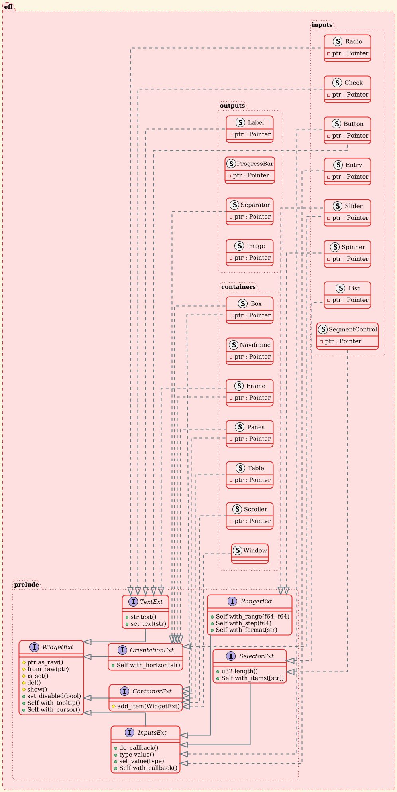

# efl-rs

Rust bindings for the [Enlightenment Foundation Libraries](https://www.enlightenment.org/about-efl).

Published crates: [`efltk`](https://crates.io/crates/efltk) and [`efltk-sys`](https://crates.io/crates/efltk-sys).

## Other bindings for EFL

- [Python](https://github.com/DaveMDS/python-efl)
- [Vala](https://github.com/freesmartphone/libeflvala)

## Alternatives

- [FLTK-rs](https://github.com/fltk-rs)
- [GTK-rs](https://github.com/gtk-rs)
- [RSTK](https://codeberg.org/peterlane/rstk)
- [FoxTK-rs](https://github.com/theavege/foxtk-rs)

## Dependencies

See [CONTRIBUTING.md](CONTRIBUTING.md) for Linux, macOS, and Windows (MSYS2) setup.

CI build script: [.github/workflows/make.sh](.github/workflows/make.sh), [workflow](.github/workflows/main.yml).

## Guides

- [Getting started](docs/getting_started.md)
- [Threading model](docs/threading.md)
- [Memory and lifetimes](docs/memory.md)
- [Migrating from GTK](docs/migrating_from_gtk.md)
- [Migrating from 0.0.x to 0.1.0](docs/migrating_0_0_x.md)

## Support

The minimum supported Rust version (MSRV) is **1.85**, using edition 2024.
The native library requirement is EFL **1.25 or newer**. The build script
reports the detected version and warns when it is below 1.25.

| Platform | CI coverage | Native EFL setup |
| --- | --- | --- |
| Ubuntu Linux | Build, tests, docs, examples, and Xvfb smoke tests | `libefl-all-dev` |
| macOS | Build, tests, docs, and examples | Homebrew `efl` |
| Windows | Build and tests through MSYS2 `clang64` | MSYS2 `efl` package |

The table describes automated coverage, not a guarantee that every EFL backend
or optional widget feature is available on every distribution.

```toml
[dependencies]
efltk = "0.0.8"
```

## First window

Install the native EFL development dependencies for your platform (see
[CONTRIBUTING.md](CONTRIBUTING.md)), then create a window, add a vertical box,
and put a label and button inside it. The button callback updates the label:

```rust,no_run
use efltk::prelude::*;
use efltk::{Box as EflBox, Button, Label, Window};

fn main() {
    run(|| {
        let window = Window::new("first-window", "My first efltk app").with_min_size(320, 160);

        EflBox::new(&window).with_padding(12).inside(|column| {
            let message = Label::new(column).with_text("Welcome to efltk!");
            Button::new(column)
                .with_text("Click me")
                .with_callback(move |_| message.set_text("The callback updated this label."));
        });

        window
    });
}
```

Run the same example from the repository with:

```sh
cargo run -p efltk --example first_window
```

## Examples

```sh
cargo run -p efltk --example first_window
cargo run -p efltk --example simple
cargo run -p efltk --example snake
cargo run -p efltk --example floppy_bird
```

`snake` and `floppy_bird` are LÖVE-style loops (`load` / `update` / `draw` / `keypressed`, plus click-to-flap on Floppy Bird) drawn with `GLView`.

## Work in process

- [x] [Widgets](https://www.enlightenment.org/_legacy_embed/widgetslist.html)
  - [x] [Containers](docs/elm_containers.md)
    - [x] [Box](docs/elm_containers.md#Box) - is horizontal/vertical container.
    - [x] [NaviFrame](docs/elm_containers.md#NaviFrame) - is a container that shows a single child at a time.
    - [x] [Frame](docs/elm_containers.md#Frame) - allows to provide additional content that is initially hidden.
    - [x] [Panes](docs/elm_containers.md#Panes) - divides its content area into two panes with a divider in between that the user can adjust.
    - [x] [Table](docs/elm_containers.md#Table) - grid of cells (`pack` col/row/span).
    - [x] [Scroller](docs/elm_containers.md#Scroller) - single-child viewport with scrollbars.
  - [x] [Outputs](docs/elm_outputs.md)
    - [x] [Label](docs/elm_outputs.md#Label) - Display text
    - [x] [Separator](docs/elm_outputs.md#Separator) - Display horizontal/vertical line
    - [x] [ProgressBar](docs/elm_outputs.md#ProgressBar) - Display progress
    - [x] [Image](docs/elm_outputs.md#Image) - Display a file
  - [x] [Inputs](docs/elm_inputs.md)
    - [x] [Button](docs/elm_inputs.md#Button)
    - [x] [Check (bool)](docs/elm_inputs.md#Check) - Change option
    - [x] [Entry (String)](docs/elm_inputs.md#Entry) - Change text
    - [x] [Rangers ((f64..=f64), f64)](docs/elm_rangers.md)
      - [x] [Spinner](docs/elm_rangers.md#Spinner) - provides convenient ways to input data that can be seen as a value in a range.
      - [x] [Slider](docs/elm_rangers.md#Slider) - is a way to select a value from a range. Slider can have marks to help pick special values, and they can also restrict the values that can be chosen.
    - [x] [Selectors (Vec<String>, u32)](docs/elm_selectors.md)  - Select variant
      - [x] [Radio](docs/elm_selectors.md#Radio) - Classic selector
      - [x] [List](docs/elm_selectors.md#List) - is used to store data in list form.
      - [x] [SegmentControl](docs/elm_selectors.md#SegmentControl) - Horizontal selector
      - [x] [Menu](docs/elm_selectors.md#Menu) - Popup selector
      - [x] [Hoversel](docs/elm_selectors.md#Hoversel) - Dropdown selector
      - [x] [Diskselector](docs/elm_selectors.md#Diskselector) - Rotary selector
      - [x] [Toolbar](docs/elm_selectors.md#Toolbar) - Item bar
      - [x] [Genlist](docs/elm_selectors.md#Genlist) - Virtualized list
  - [x] Extra widgets: Calendar, Clock, ColorSelector, FileSelector, FileEntry, Bg, Panel, Notify, Photo, Datetime, Grid, Flip, Hover, Ctxpopup, Index, Dayselector, Actionslider, Bubble, Photocam, Slideshow, Gengrid, Map, Video, Web, Glview, Conformant, Layout, Multibuttonentry, Combobox

## Transition Table

Release plan for the first stable version: [Spec.md](Spec.md).

Rough equivalents between common widgets of GTK+ 3 and widgets of EFL. The ✅ column marks
widgets that already have a safe wrapper in [`efltk`](efltk/src/lib.rs).

| GTK+ | EFL | efltk |
| ---- | --- | :---: |
| [`Gtk.Widget`](https://valadoc.org/gtk+-3.0/Gtk.Widget.html) | [`Efl.Object`](https://www.enlightenment.org/develop/legacy/api/c/start#classEfl__Object) / [`Elm.Widget`](https://www.enlightenment.org/develop/legacy/api/c/start#group__Elm__Widget.html) (`WidgetExt`) | ✅ |
| [`Gtk.Container`](https://valadoc.org/gtk+-3.0/Gtk.Container.html) (depending on layout: [`Box`](https://valadoc.org/gtk+-3.0/Gtk.Box.html), [`Grid`](https://valadoc.org/gtk+-3.0/Gtk.Grid.html), [`Fixed`](https://valadoc.org/gtk+-3.0/Gtk.Fixed.html), …) | [`Elm.Box`](https://www.enlightenment.org/develop/legacy/api/c/start#group__Elm__Box.html), [`Elm.Table`](https://www.enlightenment.org/develop/legacy/api/c/start#group__Elm__Table.html), [`Elm.Overlay`](https://www.enlightenment.org/develop/legacy/api/c/start#group__Elm__Overlay.html) (`ContainerExt`) | ✅ |
| [`Gtk.Window`](https://valadoc.org/gtk+-3.0/Gtk.Window.html) | [`Elm.Window`](https://www.enlightenment.org/develop/legacy/api/c/start#group__Elm__Win__Class.html) (`WindowExt`) | ✅ |
| [`Gtk.Dialog`](https://valadoc.org/gtk+-3.0/Gtk.Dialog.html) | [`Elm.Popup`](https://www.enlightenment.org/develop/legacy/api/c/start#group__Elm__Popup.html) (`PopupExt`) | ✅ |
| [`Gtk.MessageDialog`](https://valadoc.org/gtk+-3.0/Gtk.MessageDialog.html) | [`Elm.Notify`](https://www.enlightenment.org/develop/legacy/api/c/start#group__Elm__Notify.html) / [`Elm.Popup`](https://www.enlightenment.org/develop/legacy/api/c/start#group__Elm__Popup.html) | ✅ |
| [`Gtk.Button`](https://valadoc.org/gtk+-3.0/Gtk.Button.html) | [`Elm.Button`](https://www.enlightenment.org/develop/legacy/api/c/start#group__Elm__Button.html) (`ButtonExt`) | ✅ |
| [`Gtk.CheckButton`](https://valadoc.org/gtk+-3.0/Gtk.CheckButton.html) | [`Elm.Check`](https://www.enlightenment.org/develop/legacy/api/c/start#group__Elm__Check.html) (`CheckExt`) | ✅ |
| [`Gtk.RadioButton`](https://valadoc.org/gtk+-3.0/Gtk.RadioButton.html) | [`Elm.Radio`](https://www.enlightenment.org/develop/legacy/api/c/start#group__Elm__Radio.html) (`RadioExt`) | ✅ |
| [`Gtk.Label`](https://valadoc.org/gtk+-3.0/Gtk.Label.html) | [`Elm.Label`](https://www.enlightenment.org/develop/legacy/api/c/start#group__Elm__Label.html) (`LabelExt`) | ✅ |
| [`Gtk.Entry`](https://valadoc.org/gtk+-3.0/Gtk.Entry.html) | [`Elm.Entry`](https://www.enlightenment.org/develop/legacy/api/c/start#group__Elm__Entry.html) single-line (`EntryExt`) | ✅ |
| [`Gtk.Entry`](https://valadoc.org/gtk+-3.0/Gtk.Entry.html) with `visibility = false` | [`Elm.Entry`](https://www.enlightenment.org/develop/legacy/api/c/start#group__Elm__Entry.html) with `elm_entry_password_set()` (`EntryExt::with_password`) | ✅ |
| [`Gtk.TextView`](https://valadoc.org/gtk+-3.0/Gtk.TextView.html) | [`Elm.Entry`](https://www.enlightenment.org/develop/legacy/api/c/start#group__Elm__Entry.html) multiline wrapped in [`Elm.ScrollView`](https://www.enlightenment.org/develop/legacy/api/c/start#group__Elm__Scroller.html) | ✅ |
| [`Gtk.ProgressBar`](https://valadoc.org/gtk+-3.0/Gtk.ProgressBar.html) | [`Elm.Progressbar`](https://www.enlightenment.org/develop/legacy/api/c/start#group__Elm__Progressbar.html) (`ProgressBarExt`) | ✅ |
| [`Gtk.Separator`](https://valadoc.org/gtk+-3.0/Gtk.Separator.html) | [`Elm.Separator`](https://www.enlightenment.org/develop/legacy/api/c/start#group__Elm__Separator.html) (`SeparatorExt`) | ✅ |
| [`Gtk.Image`](https://valadoc.org/gtk+-3.0/Gtk.Image.html) | [`Elm.Image`](https://www.enlightenment.org/develop/legacy/api/c/start#group__Elm__Image.html) / [`Edje`](https://www.enlightenment.org/develop/legacy/api/c/start#group__Edje__Reference) (`ImageExt`, `IconExt`) | ✅ |
| [`Gtk.Scale`](https://valadoc.org/gtk+-3.0/Gtk.Scale.html) | [`Elm.Slider`](https://www.enlightenment.org/develop/legacy/api/c/start#group__Elm__Slider.html) (`SliderExt`, `RangerExt`) | ✅ |
| [`Gtk.SpinButton`](https://valadoc.org/gtk+-3.0/Gtk.SpinButton.html) | [`Elm.Spin`](https://www.enlightenment.org/develop/legacy/api/c/start#group__Elm__Spinner.html) (`SpinnerExt`) | ✅ |
| [`Gtk.ComboBox`](https://valadoc.org/gtk+-3.0/Gtk.ComboBox.html) | [`Elm.Hoversel`](https://www.enlightenment.org/develop/legacy/api/c/start#group__Elm__Hoversel.html) / [`Elm.Combobox`](https://www.enlightenment.org/develop/legacy/api/c/start#group__Elm__Combobox.html) (`HoverselExt`) | ✅ |
| [`Gtk.ComboBoxText`](https://valadoc.org/gtk+-3.0/Gtk.ComboBoxText.html) | [`Elm.Diskselector`](https://www.enlightenment.org/develop/legacy/api/c/start#group__Elm__Diskselector.html) / [`Elm.SegmentControl`](https://www.enlightenment.org/develop/legacy/api/c/start#group__Elm__Segmentctrl.html) (`SelectorExt`) | ✅ |
| [`Gtk.MenuBar`](https://valadoc.org/gtk+-3.0/Gtk.MenuBar.html) + [`Gtk.Menu`](https://valadoc.org/gtk+-3.0/Gtk.Menu.html) | [`Elm.Menu`](https://www.enlightenment.org/develop/legacy/api/c/start#group__Elm__Ctxpopup.html) / [`Elm.Ctxpopup`](https://www.enlightenment.org/develop/legacy/api/c/start#group__Elm__Ctxpopup.html) (`MenuExt`) | ✅ |
| [`Gtk.Toolbar`](https://valadoc.org/gtk+-3.0/Gtk.Toolbar.html) | [`Elm.Toolbar`](https://www.enlightenment.org/develop/legacy/api/c/start#group__Elm__Toolbar.html) (`ToolbarExt`) | ✅ |
| [`Gtk.ScrolledWindow`](https://valadoc.org/gtk+-3.0/Gtk.ScrolledWindow.html) / [`Gtk.Viewport`](https://valadoc.org/gtk+-3.0/Gtk.Viewport.html) | [`Elm.Scroller`](https://www.enlightenment.org/develop/legacy/api/c/start#group__Elm__Scroller.html) (`ScrollerExt`) | ✅ |
| [`Gtk.Paned`](https://valadoc.org/gtk+-3.0/Gtk.Paned.html) | [`Elm.Panes`](https://www.enlightenment.org/develop/legacy/api/c/start#group__Elm__Panes.html) (`PanesExt`) | ✅ |
| [`Gtk.Notebook`](https://valadoc.org/gtk+-3.0/Gtk.Notebook.html) | [`Elm.NaviFrame`](https://www.enlightenment.org/develop/legacy/api/c/start#group__Elm__Naviiframe.html) / [`Elm.Frame`](https://www.enlightenment.org/develop/legacy/api/c/start#group__Elm__Frame.html) (`NaviframeExt`) | ✅ |
| [`Gtk.TreeView`](https://valadoc.org/gtk+-3.0/Gtk.TreeView.html) with [`ListStore`](https://valadoc.org/gtk+-3.0/Gtk.ListStore.html) | [`Elm.Genlist`](https://www.enlightenment.org/develop/legacy/api/c/start#group__Elm__Genlist.html) / [`Elm.List`](https://www.enlightenment.org/develop/legacy/api/c/start#group__Elm__List.html) (`GenlistExt`, `ListExt`) | ✅ |
| [`Gtk.TreeView`](https://valadoc.org/gtk+-3.0/Gtk.TreeView.html) with [`TreeStore`](https://valadoc.org/gtk+-3.0/Gtk.TreeStore.html) | [`Elm.Genlist`](https://www.enlightenment.org/develop/legacy/api/c/start#group__Elm__Genlist.html) nested groups / [`Elm.Index`](https://www.enlightenment.org/develop/legacy/api/c/start#group__Elm__Index.html) | ✅ |
| [`Gtk.ColorButton`](https://valadoc.org/gtk+-3.0/Gtk.ColorButton.html) / [`Gtk.ColorSelection`](https://valadoc.org/gtk+-3.0/Gtk.ColorSelection.html) (deprecated) | [`Elm.ColorSelector`](https://www.enlightenment.org/develop/legacy/api/c/start#group__Elm__Colorscheme.html) (`ColorSelExt`) | ✅ |
| [`Gtk.FileChooserDialog`](https://valadoc.org/gtk+-3.0/Gtk.FileChooserDialog.html) | [`Elm.FileSelector`](https://www.enlightenment.org/develop/legacy/api/c/start#group__Elm__Fileselector.html) + [`Elm.FileEntry`](https://www.enlightenment.org/develop/legacy/api/c/start#group__Elm__Fileselector.html) (`FileSelExt`, `FileEntryExt`) | ✅ |
| [`Gtk.Calendar`](https://valadoc.org/gtk+-3.0/Gtk.Calendar.html) | [`Elm.Calendar`](https://www.enlightenment.org/develop/legacy/api/c/start#group__Elm__Calendar.html) / [`Elm.Clock`](https://www.enlightenment.org/develop/legacy/api/c/start#group__Elm__Clock.html) (`CalendarExt`, `ClockExt`) | ✅ |
| [`Gtk.Tooltip`](https://valadoc.org/gtk+-3.0/Gtk.Tooltip.html) (on any widget) | [`Elm.Widget`](https://www.enlightenment.org/develop/legacy/api/c/start#group__Elm__Widget.html) `elm_object_tooltip_text_set()` (`WidgetExt::with_tooltip`) | ✅ |
| [`Gtk.Layout`](https://valadoc.org/gtk+-3.0/Gtk.Layout.html) (themable container) | [`Elm.Layout`](https://www.enlightenment.org/develop/legacy/api/c/start#group__Elm__Layout.html) (`LayoutExt`) | ✅ |
| [`Gtk.DrawingArea`](https://valadoc.org/gtk+-3.0/Gtk.DrawingArea.html) | [`Elm.GLView`](https://www.enlightenment.org/develop/legacy/api/c/start#group__Elm__GLview.html) / raw [`Evas`](https://www.enlightenment.org/develop/legacy/api/c/start#group__Evas__Canvas.html) (`GlApi`, `GlviewExt`) | ✅ |
| [`WebKitWebView`](https://valadoc.org/webkit2gtk-4.0/WebKit.WebView.html) | [`Elm.Web`](https://www.enlightenment.org/develop/legacy/api/c/start#group__Elm__Web.html) (`WebExt`) | ✅ |
| [`Gtk.Video` via GStreamer](https://valadoc.org/gtk+-3.0/Gtk.Image.html) | [`Elm.Video`](https://www.enlightenment.org/develop/legacy/api/c/start#group__Elm__Video.html) (`VideoExt`) | ✅ |
| — (no direct equivalent) | [`Elm.Map`](https://www.enlightenment.org/develop/legacy/api/c/start#group__Elm__Map.html), [`Elm.Gengrid`](https://www.enlightenment.org/develop/legacy/api/c/start#group__Elm__Gengrid.html), [`Elm.Slideshow`](https://www.enlightenment.org/develop/legacy/api/c/start#group__Elm__Slideshow.html), [`Elm.Photo`](https://www.enlightenment.org/develop/legacy/api/c/start#group__Elm__Photo.html), [`Elm.Flip`](https://www.enlightenment.org/develop/legacy/api/c/start#group__Elm__Flip.html), [`Elm.Bubble`](https://www.enlightenment.org/develop/legacy/api/c/start#group__Elm__Bubble.html), [`Elm.Actionslider`](https://www.enlightenment.org/develop/legacy/api/c/start#group__Elm__Actionslider.html), [`Elm.Dayselector`](https://www.enlightenment.org/develop/legacy/api/c/start#group__Elm__Datetime.html), [`Elm.Datetime`](https://www.enlightenment.org/develop/legacy/api/c/start#group__Elm__Datetime.html), [`Elm.Photocam`](https://www.enlightenment.org/develop/legacy/api/c/start#group__Elm__Photocam.html), [`Elm.Multibuttonentry`](https://www.enlightenment.org/develop/legacy/api/c/start#group__Elm__Multibuttonentry.html), [`Elm.Conformant`](https://www.enlightenment.org/develop/legacy/api/c/start#group__Elm__Conform.html), [`Elm.Bg`](https://www.enlightenment.org/develop/legacy/api/c/start#group__Elm__Bg.html), [`Elm.Panel`](https://www.enlightenment.org/develop/legacy/api/c/start#group__Elm__Panel.html), [`Elm.Grid`](https://www.enlightenment.org/develop/legacy/api/c/start#group__Elm__Grid.html), [`Elm.Hover`](https://www.enlightenment.org/develop/legacy/api/c/start#group__Elm__Hover.html) | ✅ (extra) |

## Screenshots


## [UML: Class Diagram](https://plantuml.com)


