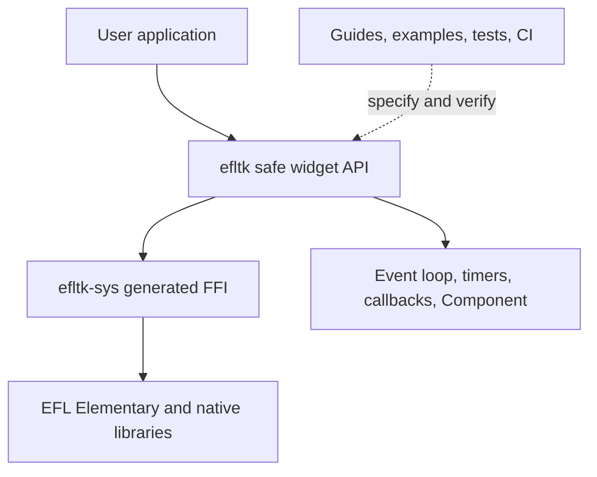

# Project Specification: efl-rs

| Status | Architecture and release requirements for the pre-1.0 project |
| --- | --- |
| Current crate versions | `efltk` and `efltk-sys` 0.0.8 |
| First stable target | 0.1.0 |

This document describes the project's purpose, current architecture, public
contracts, known architectural gaps, and the criteria for its first stable
release. It replaces an implementation checklist that no longer matched the
code. Current behavior and required behavior are identified separately where
they differ.

## 1. Purpose

`efl-rs` provides Rust bindings for the Enlightenment Foundation Libraries,
with `efltk` offering an ergonomic, trait-based API for Elementary widgets and
`efltk-sys` exposing generated low-level FFI bindings.

The project should let Rust applications build native EFL interfaces while
using EFL for widget behavior, rendering, layout, and the main event loop. It is
not a new renderer or a replacement GUI toolkit.

### Goals

- Expose the commonly used Elementary widgets and their native capabilities.
- Keep ordinary widget creation and use safe, clear, and consistent.
- Make ownership, invalidation, callback, initialization, and threading rules
  explicit at the Rust API boundary.
- Support Linux, macOS, and Windows where EFL and its development tools are
  available.
- Keep the generated FFI layer separate from the application-facing API.
- Make releases and supported configurations reproducible through CI.

### Non-goals for 0.1.0

- Reimplementing EFL rendering, themes, or widgets in Rust.
- Binding every EFL library or every function in EFL. The high-level crate
  covers Elementary and only the supporting Evas/Ecore functionality it needs.
- Integrating an async runtime such as Tokio.
- Providing visual designer or theme-editor tooling.

## 2. Workspace and dependency direction

Dependencies flow in one direction: `efltk` depends on `efltk-sys`; the sys
crate must not depend on the high-level crate. Applications normally depend on
`efltk`, and use `efltk::prelude::*` for widget extension traits.

### `efltk-sys`

- Uses `pkg-config` to locate the installed `elementary` development package.
- Uses bindgen and `Elementary.h` to generate bindings during the build.
- Links the native Elementary library and exposes generated FFI declarations.
- Reports the detected EFL version. EFL 1.25 or newer is the documented
  baseline; the build currently warns about older versions rather than
  enforcing a hard upper or lower bound.
- Owns platform-specific bindgen configuration and blocklists generated libc
  and EFL internal declarations that should not appear in the Rust interface.

Generated bindings are unsafe, low-level interfaces. `efltk-sys` is not the
recommended API for ordinary widget application code.

### `efltk`

- Owns the public widget handle types, common error types, and extension-trait
  API.
- Translates Rust strings, enums, values, and closures to the native ABI.
- Provides the EFL run loop, `Timer`, `spawn_main`, and the `Component`
  event/state/view pattern.
- Has no required third-party Rust runtime dependency beyond `efltk-sys`.
  Optional widget groups are controlled by Cargo features; application-only
  helper dependencies belong in development dependencies.

The implementation is currently concentrated in `src/lib.rs` and
`src/prelude.rs`. It may be divided into private modules by responsibility as
it grows, while preserving intentional root and prelude re-exports.

## 3. Public API architecture

### Widget wrappers and traits

Concrete widget types (`Window`, `Button`, `Label`, containers, selectors, and
others) are lightweight handles over EFL objects. The prelude groups shared
capabilities into traits such as:

- `WidgetExt`: common object operations and access to raw pointers.
- `ContainerExt`: adding and managing child content.
- `TextExt` and `InputExt<T>`: text and value access.
- `OrientExt`, `RangerExt`, and `SelectorExt`: shared widget behavior.
- Widget-specific extension traits: creation and functionality unique to a
  particular widget.

Constructors should be associated with the trait for the relevant widget
family. Builder-style `with_*` methods configure a newly created widget;
`set_*` and getter pairs mutate or inspect existing widgets. Item containers
should use consistent `try_add`, `length`, and `clear` behavior.

### Features

The `web`, `map`, `video`, and `photocam` Cargo features gate their associated
widget wrappers. They are enabled by default today; `--no-default-features`
selects the core API. Feature flags must remain additive: enabling or disabling
one optional widget group must not silently change the behavior of unrelated
widgets. CI should compile both the minimal and all-feature configurations.

### Error handling

`EflError` and `EflResult<T>` represent invalid strings, empty wrappers, null
native results, invalid indices, and invalid ranges. Fallible `try_*` APIs are
the required choice when values come from users or other external input.

The existing API also contains convenience methods that panic on invalid
strings or return defaults for some failures. These remain compatibility
wrappers during the 0.x series. Before 0.1.0, every fallible native operation
must have a clear result contract, and the behavior of any legacy convenience
method must be documented rather than silently swallowing a meaningful error.

## 4. Native object ownership and invalidation

EFL owns widget and item allocations. Rust wrappers are non-owning handles;
creating or dropping a wrapper does not create or delete the native object.
Containers own child objects, and item collections own their items.

The current handle representation stores an optional non-null native pointer.
`Default` creates an empty wrapper. `is_set()` means that the wrapper contains a
pointer; it does **not** query whether EFL has since deleted that object.

Calling `del()` on an object, deleting an item, or deleting a parent invalidates
all Rust handles to the deleted native object and its descendants. The current
types do not tie child lifetimes to parent lifetimes, and aliases are not
updated when another handle deletes the object. Calling a safe method through
such an invalidated handle is therefore a release-blocking soundness risk.

### Required decision before 0.1.0

Choose and implement one coherent invalidation contract:

1. Track native deletion so all aliases become detectably empty before any safe
   operation can use the pointer; or
2. Redesign destructive/raw operations and handle construction so invalidation
   cannot be reached through safe Rust, with explicit unsafe contracts for
   operations that can invalidate other handles.

Document the selected model in the memory guide and cover deletion through a
widget, item, and parent with tests. Do not describe `is_set()` as proof that a
native object is still alive.

Raw-pointer constructors for widgets, items, timers, and GL API tables are
`unsafe`. Their safety documentation must require a pointer of the right type,
from the active EFL instance/thread, that remains valid for every use.

## 5. Threading, callbacks, and runtime lifecycle

### Threading

EFL objects are confined to the thread that initializes and runs EFL. Widget,
timer, and item handles must remain `!Send` and `!Sync`.

`spawn_main` is intended to marshal work from worker threads to the EFL thread.
Its current signature accepts a non-`Send` closure and its implementation
creates an Ecore timer directly. Before this API can promise cross-thread use,
it must require `Send + 'static` and use an EFL-supported thread-safe dispatch
mechanism. Otherwise it must be explicitly restricted to calls already made
on the EFL thread. The threading guide and implementation must agree.

### Callbacks

Rust closures passed to C are owned by the corresponding EFL object, timer, or
component mount. Each callback allocation must be released exactly once when
its native owner is deleted or stopped. A Rust panic must never unwind through
an `extern "C"` callback boundary; current callback trampolines use
`catch_unwind` for this purpose.

### Run loop and timers

- `run` initializes EFL, creates and shows the window, runs the main loop, then
  shuts EFL down.
- `run_with_guard` keeps a caller-provided guard alive through the loop and
  drops it before EFL shutdown. Use it for timers and other resources whose
  destructors call EFL.
- `exit` requests termination of the active loop; `run` must not be called
  recursively from a callback.
- `Timer::del()` stops the native timer and releases its callback. Timer
  creation failure must also release the callback allocation.
- `Component::mount` creates the component view and polls its event channel on
  the EFL loop. It returns a `ComponentMount`; callers must retain that handle
  for the component's active lifetime and stop it before deleting its parent.
  `Component::run` owns its top-level mount through shutdown.

Current gap: `run` returns `EflResult<()>`, but the implementation does not
currently convert the return value of `elm_init` into an error. The runtime
contract and implementation must be reconciled before stable release.

## 6. `Component` architecture

A component separates four roles:

- `Event`: messages produced by user interaction or application work.
- `State`: the model reduced by `handle`.
- `view`: creates widgets and sends events through a channel.
- `update`: reflects changed model state into existing widgets.

`mount` builds the view, applies initial state, then periodically drains queued
events and calls `update` when `handle` reports that rendering is needed. The
mount handle is the owner of this polling lifetime. Current behavior polls each
component's channel on a 40 ms Ecore timer, including when no events are queued;
the cost and latency of that policy should be measured before scaling it to
large numbers of mounted components.

Before 0.1.0, document the meaning of the `bool` returned by `handle`, define
how a component reports mount or timer creation failure, and ensure parent
widget removal stops polling before child handles become invalid. Avoid adding
new framework abstractions until those lifecycle guarantees are clear. `State`
currently must implement `Default`; decide whether a `mount_with(initial_state)`
entry point is needed for restored or caller-supplied state.

## 7. Build, platform, and configuration support

The minimum Rust version is 1.85 and the crate uses edition 2024. The native
build requires EFL development headers, `pkg-config`, Clang, and libclang.
Platform setup instructions live in `CONTRIBUTING.md`; the tested platform
matrix lives in the README.

CI must cover Linux, macOS, and Windows/MSYS2 and include:

- Minimal-feature and all-feature builds.
- Clippy, formatting, unit tests, documentation tests, and rustdoc generation.
- Compilation of examples.
- A real EFL runtime integration test on a headless Linux display.
- Example smoke tests only when the workflow actually executes them; a skipped
  or early-exiting step does not count as coverage.

Current runtime tests are in `efltk/tests/runtime.rs`; headless setup and
commands are in `.github/workflows/main.yml` and `.github/workflows/make.sh`.
In the current worktree, only `ubuntu-latest` is enabled in the workflow matrix;
the macOS and Windows entries are commented out. The README support matrix must
match the enabled matrix, and all three platforms must be restored before the
0.1.0 platform-support requirement can be considered met.

## 8. Stable-release acceptance criteria

The 0.1.0 release is ready when all of the following are true:

1. The ownership/invalidation decision above is implemented, documented, and
   covered by tests; no safe API path can use a deleted native handle.
2. Cross-thread dispatch has a sound `Send` contract and uses a thread-safe EFL
   mechanism, or the API/docs clearly limit it to the EFL thread.
3. Initialization errors, timer creation failures, callback cleanup, and
   run-loop teardown have defined and tested behavior.
4. Public constructors, feature flags, error behavior, and trait bounds are
   documented. Public API changes for the 0.1 line follow an explicit
   compatibility policy.
5. CI passes on all supported platforms for the documented feature matrix,
   runtime tests, examples, docs, Clippy, and formatting.
6. README, guides, migration guide, changelog, crate versions, dependency pins,
   and published package contents agree with the release.
7. Both crates pass `cargo publish --dry-run`; publish `efltk-sys` before
   `efltk`, then tag the release and publish its notes.

## 9. Recommended order of work

1. Resolve handle invalidation and `spawn_main` thread-safety first; these
   define what the safe API can promise.
2. Align `run`, `Timer`, `ComponentMount`, and callback error behavior with those
   ownership and threading contracts.
3. Complete fallible API coverage and document legacy convenience behavior.
4. Keep the platform/feature CI matrix and runtime tests truthful and reliable.
5. Organize large implementation modules and finish public API/migration docs.
6. Cut 0.1.0 only after the acceptance criteria above are met.

## 10. Deferred work

The following are not prerequisites for 0.1.0 unless they become necessary to
meet safety or usability requirements: async-runtime adapters, broad bindings
for non-Elementary EFL APIs, accessibility integration, theme-editor tooling,
and a 1.0 compatibility cycle.
